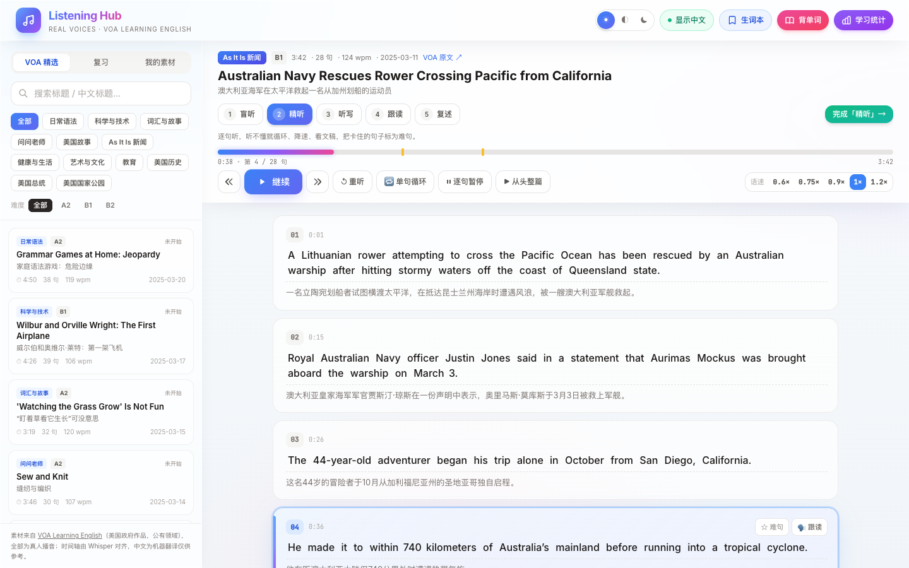
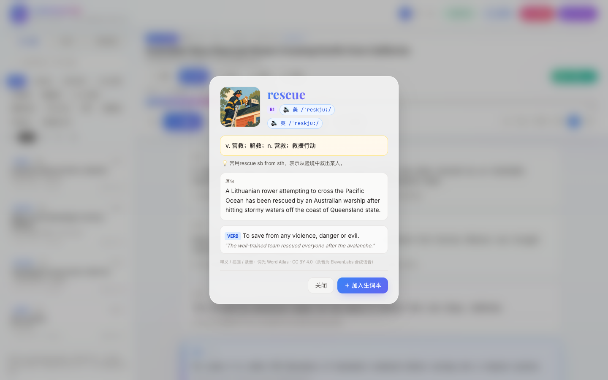
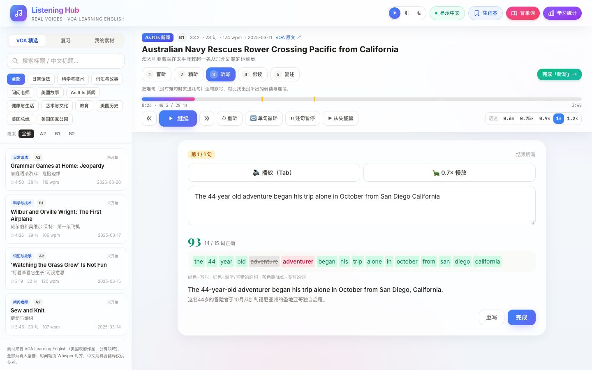
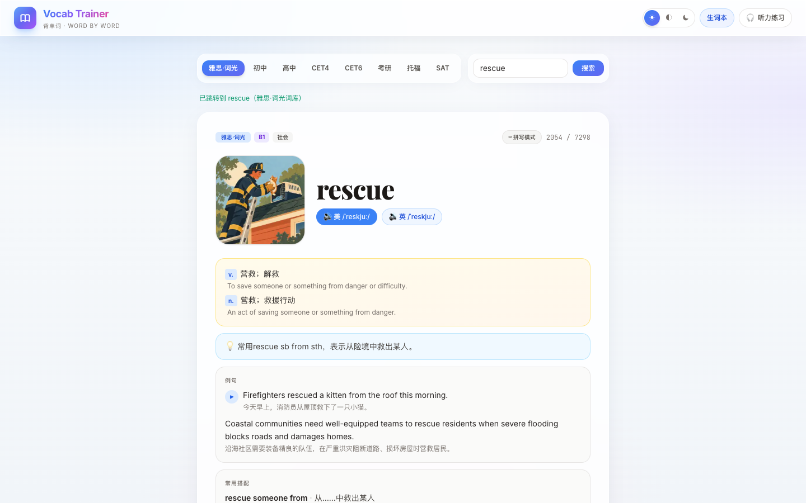
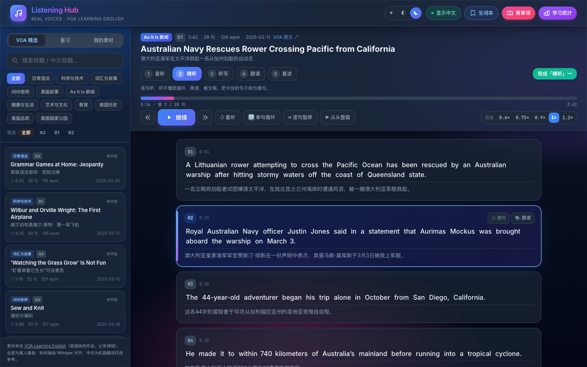

<div align="center">

[](https://github.com/Andrew-liu/ListeningHub)

</div>

<h1 align="center">Listening Hub</h1>

<div align="center">

[](https://github.com/Andrew-liu/ListeningHub/actions/workflows/deploy.yml) [](#协议) [](#在线使用) [](#内容来源与授权)<br>
[](https://vuejs.org/) [](https://tailwindcss.com/) [](#素材管线) [](#数据与隐私) [](https://github.com/Andrew-liu/ListeningHub/stargazers)

</div>

<p align="center"><b>听真人原声，逐句练到听懂，单词带图记住。</b></p>

<div align="center">



</div>

## 项目介绍

**Listening Hub 是一个纯静态的英语听力训练站点。**它把 VOA Learning English 的真人播音切成带时间轴的句子，按“盲听、精听、听写、跟读、复述”五步练习，学完后自动安排 7 轮间隔复习；背单词部分接入了词光 Word Atlas 的雅思插画词库。

没有后端，没有账号，部署在 GitHub Pages，打开网页就能用。学习进度、生词本和你导入的音频都只保存在本机浏览器里。

如果这个项目对你有帮助，欢迎点个 Star。

## 为何开发 Listening Hub

最早的版本用浏览器自带的语音合成朗读文本，机器音节奏平、没有连读和弱读，练久了反而听不惯真人说话。内容也是固定写死的，很快就没新东西可练，项目因此停滞了一段时间。

这次重构只做两件事：**音频全部换成真人原声**，用 Whisper 把官方文稿逐句对齐到音频上，做到点哪句播哪句；**按训练流程组织练习**，不只是“播放一遍”，而是盲听抓大意、精听扣细节、听写找漏洞、跟读练语调、复述检验理解，再用间隔复习把听懂的东西留住。

## 功能特性

- 真人原声素材：112 篇 VOA Learning English 播音，共 713 分钟，覆盖新闻、健康、科技、历史、习语、美国故事等 12 个栏目
- 逐句时间轴：5,382 句全部对齐到音频，点句即播、单句循环、逐句暂停，0.6× 到 1.2× 变速不变调
- 五步首学：盲听、精听、听写、跟读、复述，每一步有明确的任务和完成按钮
- 7 轮间隔复习：首学完成后按 6 小时、1 天、2 天、4 天、7 天、14 天、28 天自动排期
- 难句本：按 `H` 标记卡住的句子，听写低于 80 分的句子自动收录，跨篇目集中复练
- 导入自己的素材：音频加 LRC、SRT 或 VTT 字幕，支持中英双语行，存在本机不上传
- 生词本连着原句：收藏单词时保存所在句子和时间点，复习时直接回放那一句原声
- 词光雅思词库：7,298 词，每词一幅插画，带 CEFR 分级、英美发音、例句朗读、搭配和辨析
- 三色主题与 PWA：明亮、暗黑、复古三种主题，可安装到桌面或手机主屏

## 三个模块

| 模块   | 用来做什么                         | 核心能力                                                         |
| ------ | ---------------------------------- | ---------------------------------------------------------------- |
| 听力   | 用真人原声做精听训练               | 逐句时间轴、五步首学、难句本、听写比对、跟读与复述录音、本地导入 |
| 复习   | 把听过的篇目和难句真正留住         | 7 轮篇目复习、难句集中复练、生词 SM-2 复习、原句原声回放         |
| 背单词 | 系统地过词库，补齐听力里的生词     | 8 个词库 33,986 词、词光插画与录音、拼写与默写、错词进生词本     |

## 产品演示

<div align="center">

|                 查词弹窗                  |                 听写比对                 |
| :---------------------------------------: | :--------------------------------------: |
|  |  |

|               词光背单词                |                    暗色模式                    |
| :-------------------------------------: | :--------------------------------------------: |
|  |  |

</div>

> 演示截图由 `npm run screenshots` 自动生成，使用全新的浏览器存储，不包含真实学习记录。

## 功能详解

<details>
<summary><b>听力素材与播放</b></summary>

- 素材按栏目和难度（A2 / B1 / B2）筛选，支持按英文或中文标题搜索；每篇显示时长、句数、语速（每分钟词数）和发布日期，并附 VOA 原文链接。
- 点击任意句子只播放这一句，播完自动停在句尾；开启“单句循环”后间隔 0.6 秒重播。
- “从头整篇”连续播放，当前句自动高亮并滚动到视野中央；开启“逐句暂停”后每句结束自动暂停，按空格继续下一句。
- 变速使用浏览器原生的保持音高播放，慢放不会变调。
- 进度条上用黄色刻度标出难句位置，点击进度条可跳转。
- 快捷键：`Space` 播放/暂停，`←` `→` 上一句/下一句，`R` 重听，`L` 循环，`H` 标记难句，`Z` 显示/隐藏中文。

</details>

<details>
<summary><b>五步首学与间隔复习</b></summary>

- **盲听**：默认隐藏文稿，只播放音频；页面给出本篇关键词，模糊处理，听完再揭开自查。可以“偷看文稿”。
- **精听**：逐句听，配合循环、降速、显示中文；卡住的句子按 `H` 标为难句。
- **听写**：自动选取难句（没有难句时选几句代表句），也可以全文听写；提交后逐词比对，漏听和写错的词标红，多写的词划掉，低于 80 分的句子自动进难句本。
- **跟读**：逐句播放原声后录音，可以单独回放，也可以“原声接我的录音”连续对比。
- **复述**：只看关键词，录一段 1 到 2 分钟的复述，再对照原文。
- 完成最后一步后进入复习计划。到期篇目出现在侧栏“复习”页，复习内容为盲听一遍、难句精听一遍、复述一遍。7 轮全部完成后标记为“已掌握”。

</details>

<details>
<summary><b>导入自己的素材</b></summary>

- 在侧栏“我的素材”中选择音频文件（MP3、M4A、WAV 等，也可以是 MP4）和字幕文件。
- 字幕支持 LRC、SRT、VTT。同一时间戳下的中英两行、同一行里用 `/` 或 `|` 分隔的中英文，都会自动识别成英文原文加中文译文。
- 文件保存在浏览器 IndexedDB 中，刷新和重启后仍在，不会上传到任何服务器；导入时会申请持久化存储，减少被浏览器清理的可能。
- 导入的素材和 VOA 素材共用同一套五步训练、难句本和复习计划。
- 请只导入你有权使用的内容。

</details>

<details>
<summary><b>查词与生词本</b></summary>

- 点击句子里的任意单词弹出查词卡：英美音标与发音、中文释义、英文释义，以及单词所在的原句。
- 词光收录的词会额外显示插画、CEFR 分级和用法提示；`rescued`、`studies` 这类变形词会自动找到原形词条。
- 收藏时保存原句、所属篇目和时间点。生词本和复习卡片上都有“听原句”按钮，播放的是那一句真人原声。
- 复习采用简化的 SM-2 算法，按“忘记、困难、还行、熟练”四档安排下次时间。
- 支持导出 Anki 导入格式和 CSV，导出内容包含原句。
- 单词发音优先用词光录音，其次用 Free Dictionary 的录音，都找不到时才回退到浏览器朗读。听力素材本身从不使用合成语音。

</details>

<details>
<summary><b>背单词</b></summary>

- 词库：雅思·词光（7,298）、初中、高中、CET4、CET6、考研、托福、SAT，共 33,986 词，按 200 词一片按需加载。
- 词光词条显示插画（点击切换 512px 大图）、CEFR 分级、话题、每个义项的英文释义、两条例句及朗读、常用搭配、词族、近反义词和辨析提示。
- 支持跨词库搜索单词，每个词库单独记住学习位置。
- 拼写模式直接敲键盘逐字母输入，打错清空重来；默写模式隐藏单词，只听发音拼写。错误次数换算成记忆评分，错 3 次的词自动进生词本。
- 快捷键：`←` `→` 切换单词，`P` 发音，`Space` 显示/隐藏释义。

</details>

<details>
<summary><b>外观与离线</b></summary>

- 明亮、暗黑、复古三种主题，听力和背单词页面都可以切换。
- 手机端侧栏折叠为抽屉，打开篇目后自动收起。
- Service Worker 缓存应用代码、数据和插画，断网时仍能打开已访问过的页面；音频交给浏览器 HTTP 缓存，不拦截分段请求，保证逐句跳转准确。
- 每次部署时，工作流会把缓存名替换为 commit sha，新版本发布后立即生效。

</details>

## 在线使用

访问 [andrew-liu.github.io/ListeningHub](https://andrew-liu.github.io/ListeningHub/)。桌面浏览器建议使用 Chrome、Edge 或 Safari 的较新版本；跟读和复述录音需要允许麦克风权限。

在浏览器菜单中选择“安装”或“添加到主屏幕”，即可像应用一样使用。

## 开发与构建

站点没有构建步骤，Vue 和 Tailwind 通过 CDN 加载，代码是原生 ES Module。环境要求：Node.js 18 及以上（只用于本地服务和测试）。

```sh
# 安装开发依赖（本地服务器 + 测试用的 Playwright）
npm install

# 本地预览，打开 http://localhost:8080
npm run serve
```

> 逐句播放依赖 HTTP Range 请求，请使用上面的 `http-server`，不要用 `python -m http.server`，后者不支持 Range，句子跳转会失效。

推送到 `main` 或 `master` 分支后，[deploy.yml](.github/workflows/deploy.yml) 会自动发布到 GitHub Pages。首次使用需要在仓库 Settings → Pages 中把 Source 设为 “GitHub Actions”。

## 素材管线

听力素材和词库数据都是离线预处理后提交到仓库的，网页运行时不做任何识别或翻译。

```text
VOA 文章页 ──crawl──▶ 标题、官方文稿、MP3 地址、Words in This Story
     MP3 ──audio──▶ ffmpeg 转为 48kbps 单声道
         ──align──▶ mlx-whisper 词级时间戳，与官方文稿逐词比对，得到每句起止时间
         ──translate──▶ 本地大模型（OpenAI 兼容接口）翻译句子与生词释义
         ──build──▶ data/listening/index.json 与 episodes/<id>.json
```

```sh
# 准备环境（Apple Silicon，mlx-whisper 依赖 Metal）
uv venv --python 3.11 .venv
uv pip install --python .venv/bin/python mlx-whisper imageio-ffmpeg
ln -sf "$(.venv/bin/python -c 'import imageio_ffmpeg;print(imageio_ffmpeg.get_ffmpeg_exe())')" .venv/bin/ffmpeg

# 栏目与每栏篇数在 scripts/voa/pipeline.py 的 PROGRAMS 中配置
.venv/bin/python scripts/voa/pipeline.py crawl
.venv/bin/python scripts/voa/pipeline.py audio
.venv/bin/python scripts/voa/pipeline.py align
LLM_API=http://localhost:8000/v1 LLM_MODEL=<模型名> .venv/bin/python scripts/voa/pipeline.py translate
.venv/bin/python scripts/voa/pipeline.py build

# 同步词光词库（缺省时自动浅克隆上游仓库，约 700MB）
python3 scripts/atlas/import_atlas.py
```

- 每一步的中间结果缓存在 `scripts/.cache/`（已加入 `.gitignore`），可以中断后继续；`--force` 忽略缓存重做。
- 翻译可以开两个进程并行，第二个加 `--reverse` 从末尾往前处理。
- `build` 只输出文稿与音频词匹配率不低于 60% 的篇目。当前 112 篇的匹配率中位数为 96.7%。
- 扩充素材前先用 `du -sh audio data` 看总量，GitHub Pages 站点上限为 1GB，当前约 520MB。

## 测试

```sh
# 先在另一个终端执行 npm run serve
npm test             # 端到端测试：逐句播放与句末停止、变速、难句、连续播放、
                     # 查词与收藏、听写、五步首学与复习排期、词光背单词、
                     # 本地导入 LRC 与持久化、SRT 解析、听写比对
npm run screenshots  # 重新生成 docs/images 下的 README 截图
```

测试通过 Playwright 驱动本机 Chrome。路径不同时用环境变量 `CHROME` 指定浏览器，用 `BASE` 指定站点地址，例如 `BASE=http://localhost:8080/index.html npm test`。

## 技术栈

| 层级     | 选型                                                                |
| -------- | ------------------------------------------------------------------- |
| 界面     | Vue 3（CDN，组合式 API）、Tailwind CSS、原生 ES Module，无构建步骤 |
| 播放     | 原生 `<audio>` 分段播放：按句子时间戳 seek、`requestAnimationFrame` 精确停句、保持音高变速 |
| 本地数据 | localStorage 保存进度与生词本，IndexedDB 保存导入的音频和字幕      |
| 离线     | Service Worker（代码与数据网络优先，插画缓存优先，音频直通）       |
| 素材管线 | Python、ffmpeg、mlx-whisper（large-v3-turbo）、本地大模型翻译      |
| 部署     | GitHub Actions + GitHub Pages                                       |
| 测试     | Playwright 驱动的端到端测试                                         |

## 数据与隐私

- 学习进度、训练状态、生词本只保存在本机浏览器，不收集遥测，不需要账号。
- 导入的音频和字幕保存在本机 IndexedDB，不会上传。
- 查词时会请求 [Free Dictionary API](https://dictionaryapi.dev/)，查不到词光词条时会请求 [MyMemory](https://mymemory.translated.net/) 翻译单词，请求内容只有单词本身。
- 清除浏览器网站数据会删除以上所有内容。需要保留生词时，先用 Anki 或 CSV 导出。

## 内容来源与授权

| 内容                         | 来源                                                                  | 授权与说明                                                                                                   |
| ---------------------------- | --------------------------------------------------------------------- | ------------------------------------------------------------------------------------------------------------ |
| 听力音频与英文文稿           | [VOA Learning English](https://learningenglish.voanews.com)          | 美国政府作品，公有领域，允许教育与商业用途转载，需注明出处；通讯社图片受版权保护，本项目未收录任何图片 |
| 句子时间轴                   | 本项目用 Whisper 生成                                                 | 随代码采用 MIT                                                                                               |
| 中文译文与生词释义           | 本项目用本地大模型机器翻译                                            | 仅供参考，可能有误                                                                                           |
| 雅思词库、插画、单词与例句录音 | [词光 Word Atlas](https://github.com/designfuchen/word-atlas)       | CC BY 4.0，署名 Word Atlas contributors（词光）；只转换了数据格式。上游说明内容由 AI 生成，未逐条人工审校，录音为 ElevenLabs 合成语音 |
| 其它词库                     | [KyleBing/english-vocabulary](https://github.com/KyleBing/english-vocabulary) | 遵循上游授权                                                                                     |

完整署名与修改说明见 [ATTRIBUTION.md](ATTRIBUTION.md)。训练方法参考了 [Echo Loop](https://github.com/echo-loop/Echo-Loop) 的公开介绍，没有使用其代码。

## 项目结构

```text
ListeningHub/
├── index.html            # 页面模板与样式
├── app.js                # 入口：主题、打卡、成就、生词本、查词、复习
├── js/
│   ├── lib/              # 分段播放器、字幕解析、IndexedDB、词光访问、工具函数
│   ├── listening/        # 听力模块与训练流程
│   └── vocab/            # 背单词模块
├── data/
│   ├── listening/        # VOA 篇目索引与逐句时间轴
│   ├── vocab/            # 8 个词库分片
│   └── atlas/            # 词光缩略图、单词录音、查找表
├── audio/voa/            # VOA 真人音频
├── scripts/
│   ├── voa/pipeline.py   # VOA 素材管线
│   └── atlas/            # 词光词库导入
├── tests/                # 端到端测试与截图脚本
├── docs/images/          # README 图片
├── service-worker.js     # 离线缓存
└── ATTRIBUTION.md        # 第三方内容署名
```

## 参与贡献

欢迎通过 [Issues](https://github.com/Andrew-liu/ListeningHub/issues) 反馈问题或推荐想加入的素材。提交代码前请先运行 `npm test`；改动了界面的话，再运行 `npm run screenshots` 更新截图。

## 协议

本项目代码采用 MIT License 开源；第三方内容遵循[内容来源与授权](#内容来源与授权)中列出的各自授权。
